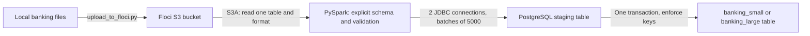

# Load banking files from Floci S3 into PostgreSQL with PySpark

This lab uses your existing Floci API on port **4566** and PostgreSQL on **5432**. Floci UI on **4500** is for viewing resources; it is not the S3 API endpoint. The supplied Docker Compose service runs only the Python/Spark client, so it does not start competing database or Floci services.



## 1. Open this folder and configure connections

Start PowerShell at the root of your `data-appliance` checkout, then run:

```powershell
git pull
cd domains/banking/pipelines/s3_to_postgres
Copy-Item .env.example .env
notepad .env
```

Edit `PGDATABASE`, `PGUSER` and `PGPASSWORD` to match your PostgreSQL instance. The screenshot does not reveal these credentials. Use a dedicated tutorial database, such as `banking_training`. If it does not exist, connect as an authorized database administrator in DBeaver/pgAdmin and run:

```sql
CREATE DATABASE banking_training;
```

Run that statement outside a transaction. Your tutorial login needs database CONNECT and CREATE privileges and must own the schemas/tables it creates. The scripts do not create database users or change passwords. Keep `.env` local; it is ignored by Git.

The defaults in `.env.example` use `host.docker.internal` because Spark runs inside Docker Desktop and connects through the host's published ports. Leave the existing Floci/PostgreSQL containers running. If your Docker Desktop configuration cannot reach a loopback-only published PostgreSQL port, connect the runner to the database's Docker network and set `PGHOST` to its service name; do not change the database to public exposure just for this lab.

| Where Python/Spark runs | S3 endpoint | PostgreSQL host |
|---|---|---|
| Supplied Docker runner on Docker Desktop | `http://host.docker.internal:4566` | `host.docker.internal` |
| Directly on Windows host | `http://localhost:4566` | `localhost` |
| Container on the same networks as the services | `http://floci:4566` (service alias) | PostgreSQL service alias |

Both endpoints must be reachable from the runner. The existing containers in your screenshot belong to different Compose projects; their service names are not automatically resolvable across projects. For native Linux Docker, use shared container networks if published loopback ports are inaccessible through the host gateway.

Use the same local Floci access key/secret and region for both upload and Spark reads. Defaults are `test` / `test`, `us-east-1`. If your Floci instance has signature validation or account isolation configured, use its configured credentials. Never use real AWS credentials for this local exercise.

## 2. Build the Spark runner

```powershell
docker compose build runner
docker compose run --rm runner load_csv.py --help
```

The image provides Python 3.11, Java 17, PySpark 3.5.8, PyArrow, boto3 and psycopg. On first Spark startup, Maven downloads Hadoop AWS 3.3.4 (plus its matching AWS SDK) and the PostgreSQL JDBC driver 42.7.14. Internet access is needed for the image build and first dependency download. The named `spark-ivy` volume caches the JARs for later runs.

Hadoop AWS must match Spark's Hadoop client version. The loader checks for 3.3.4 and stops on a mismatch. Use this image instead of adding these JAR versions to an unrelated Spark 4 installation.

## 3. Create the PostgreSQL tables

```powershell
docker compose run --rm runner init_db.py --layout both
```

This applies the repository's existing DDL, including primary keys, foreign keys, indexes and snapshot uniqueness. It creates `banking_small` and `banking_large` inside your chosen database. It does not drop, truncate or migrate existing tables. Start with a fresh tutorial database if existing definitions differ.

## 4. First exercise: small customer CSV files

The checkout already contains the generated data. Upload only customers first:

```powershell
docker compose run --rm runner upload_to_floci.py --layout small --format csv --tables customers
```

To upload files you regenerated instead, add `--source /workspace/domains/banking/generated_all` if that is their location in this checkout. The source root must contain `small/` or `large/`; Docker mounts the repository at `/workspace` read-only.

The uploader creates `banking-training` if needed. It uploads 1,000 local files, each containing 10 data rows, under:

```text
s3://banking-training/banking/v3/small/customers/csv/part-00000.csv
...
s3://banking-training/banking/v3/small/customers/csv/part-00999.csv
```

Open the Floci UI at `http://localhost:4500` to inspect the bucket if desired. `S3_BUCKET` and `S3_PREFIX` in `.env` control these paths. Rerunning the uploader replaces matching object keys; it does not delete other objects.

Load all 1,000 customer files with one Spark read:

```powershell
docker compose run --rm runner load_csv.py --layout small --tables customers
docker compose run --rm runner verify_counts.py --layout small --tables customers
```

Expected output: `customers: 10,000 rows; expected 10,000`. In your SQL client:

```sql
SELECT count(*) FROM banking_small.customers;
SELECT * FROM banking_small.customers ORDER BY customer_id LIMIT 10;
```

Spark reads the table's `s3a://.../csv/` directory with `pathGlobFilter=part-*.csv`. This selects all part files while avoiding expansion into 1,000 separate input roots. CSV headers are validated and excluded from data rows. No schema inference is used: IDs are BIGINT, dates are DATE, money is DECIMAL(18,2), and booleans are BOOLEAN.

## 5. Load all small banking tables

Upload the remaining CSV files (reuploading customers is harmless):

```powershell
docker compose run --rm runner upload_to_floci.py --layout small --format csv
```

If you completed the customer exercise above, load the remaining 15 tables:

```powershell
docker compose run --rm runner load_csv.py --layout small --tables customer_address,branches,account_products,accounts,account_owners,checking_accounts,savings_accounts,properties,vehicles,loans,home_loans,personal_loans,auto_loans,loan_payments,account_transactions
docker compose run --rm runner verify_counts.py --layout small
```

Alternatively, if **all 16 destination tables are empty**, one command loads everything:

```powershell
docker compose run --rm runner load_csv.py --layout small
```

Each table should have 10,000 rows. Tables load sequentially in parent-first order, regardless of the order passed to `--tables`. A child-only load requires its parents to be loaded already.

## 6. Load the large Parquet set

Large and small schemas are independent, so you can run this after the small CSV exercise:

```powershell
docker compose run --rm runner upload_to_floci.py --layout large --format parquet
docker compose run --rm runner load_parquet.py --layout large
docker compose run --rm runner verify_counts.py --layout large
```

This reads 10 files × 100,000 rows for each of 16 tables, producing 1,000,000 rows per table. Start with just `--tables customers` on all three commands if you want a shorter first run, then select the remaining tables as shown above. Allow PostgreSQL disk space for table data, indexes, WAL and the current staging table, in addition to S3 and local files.

## 7. JSON and alternate-format exercises

JSON files are newline-delimited objects, not a single JSON array. To practice JSON, select a **fresh tutorial database** in `.env`, initialize it, then run:

```powershell
docker compose run --rm runner init_db.py --layout small
docker compose run --rm runner upload_to_floci.py --layout small --format json
docker compose run --rm runner load_json.py --layout small
docker compose run --rm runner verify_counts.py --layout small
```

All three loaders accept `--layout small|large`, `--tables all|table1,table2` and `--jdbc-partitions 1..8` (default 2). CSV, JSON and Parquet are equivalent copies of the records. Load only one format into each destination table; the scripts refuse a nonempty destination to prevent duplicates. A fresh database is the simplest way to repeat an exercise with another format.

## What students should observe

- **Files versus tasks:** 1,000 tiny files do not necessarily produce 1,000 Spark tasks. Spark can combine files into input partitions. Listing/opening many files still adds overhead; the loader prints file count and actual input partitions.
- **Local listing configuration:** The reader targets one directory and uses `pathGlobFilter` to select part files. The lab also sets `spark.sql.sources.parallelPartitionDiscovery.threshold=10000`; this is a local-lab choice, not a universal production tuning value. Uploads use eight concurrent workers; JDBC writes default to two partitions.
- **Read versus write parallelism:** `repartition(2)` shuffles rows into two JDBC write partitions. It limits simultaneous database connections; it does not change source objects. For a controlled comparison, run with `--jdbc-partitions 1`, then 2 or 4 in fresh destinations.
- **Typed parsing:** CSV/JSON use an explicit schema with FAILFAST. The loader rejects nulls, unexpected file/row counts and duplicate source primary keys before writing. Parquet is read with the same expected schema.
- **Relationships:** Parent tables load first. PostgreSQL enforces foreign keys and unique constraints at final insertion. Snapshot tables retain `snapshot_id` and their unique parent/date pair.
- **Fair comparisons:** Small has 10,000 rows/table while large has 1,000,000. These runs demonstrate both file count and data volume; they do not isolate the cost of small files. A fair performance benchmark needs the same records in different physical file layouts.

## Failure and rerun behavior

Spark JDBC commits per partition, so a direct append can partially complete. This loader writes to a uniquely named staging table, then inserts into the destination in one PostgreSQL transaction. Exact duplicate rows caused by a JDBC task retry are removed in staging. The validated source has unique primary keys. PostgreSQL constraints remain on the final table throughout.

An error rolls back the current table's final insert; previously completed tables stay committed. This is **atomic per table**, not atomic for the whole domain. Normal failures clean up staging. A killed process can leave a `_load_<id>` table: inspect it and confirm no active loader owns it before manually removing it. Run only one domain load at a time for this teaching lab.

For retry, use `verify_counts.py` to find completed versus empty tables and pass only the remaining tables to `--tables`. Do not rerun `all` against a partially loaded schema; the preflight check refuses any selected nonempty table. Keep the selected S3 prefix unchanged during a load.

## Troubleshooting

| Symptom | Check |
|---|---|
| Connection refused on 4566 | Floci is running; use API port 4566, not UI port 4500; check host versus container endpoint |
| PostgreSQL connection/authentication failure | Database exists; `.env` credentials are correct; port is reachable from Docker |
| No such bucket/key | Upload the selected table, layout and format using the same endpoint, credentials, bucket and prefix |
| S3 signature or addressing errors | Keep path-style access enabled; use the same Floci credentials for uploader and Spark |
| Maven resolution / Java class errors | Allow Maven access; use the supplied pinned Spark/Hadoop image; do not mix arbitrary AWS SDK JAR versions |
| Missing parent / foreign-key violation | Load parent tables in the same layout first; use the all-table workflow |
| Table already contains rows | Choose only remaining empty tables or a fresh tutorial database |
| Wrong file/row count | Use the exact generated fixture directory; remove ambiguity by using a new S3 prefix, then upload again |

## Files and references

See [live validation results](VALIDATION.md) for the tested formats, file counts, database constraints and failure behavior.

`upload_to_floci.py` handles upload, `init_db.py` applies DDL, `load_csv.py` / `load_json.py` / `load_parquet.py` select the format, `loader.py` contains the PySpark pipeline, `settings.py` reuses the existing banking model, and `verify_counts.py` checks PostgreSQL.

- [Floci quick start](https://floci.io/floci/getting-started/quick-start/)
- [Spark 3.5.8 JDBC options](https://spark.apache.org/docs/3.5.8/sql-data-sources-jdbc.html)
- [Hadoop 3.3.4 S3A configuration and dependency compatibility](https://hadoop.apache.org/docs/r3.3.4/hadoop-aws/tools/hadoop-aws/index.html)
- [PostgreSQL JDBC driver downloads](https://jdbc.postgresql.org/download/)
